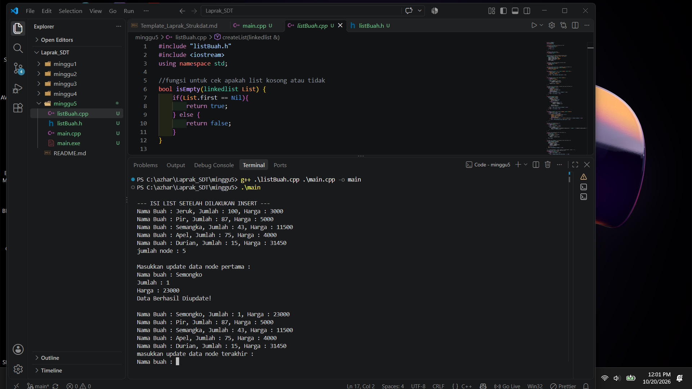
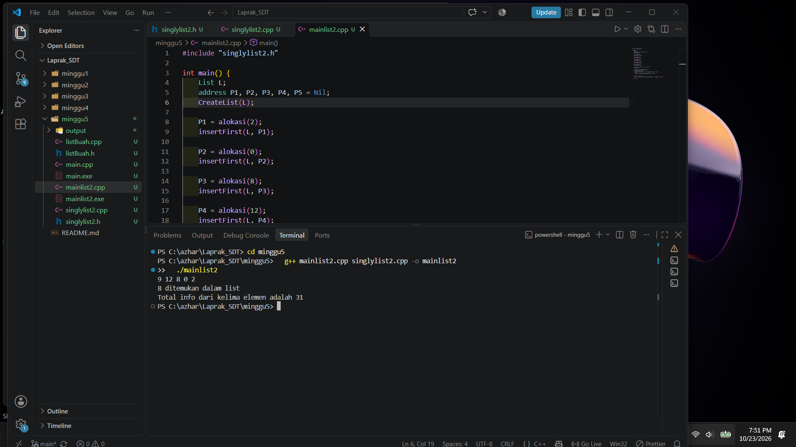

# <h1 align="center">Laporan Praktikum Modul 1 - Codeblocks IDE & Pengenalan Bahas C++ (Bagian Pertama)</h1>
<p align="center">Muhammad Azhar Nur Hafizh - 109082500049</p>

## Dasar Teori
Linked list adalah struktur data linier yang menyimpan sekumpulan elemen dalam bentuk node yang saling terhubung melalui pointer. Struktur ini cocok untuk mengelola data yang sering berubah karena penambahan, penghapusan, dan pencarian data dapat dilakukan secara dinamis tanpa harus menggeser elemen lain

### A. Struktur Data Linked List<br/>
1. Linked list adalah struktur data linier yang menyimpan elemen dalam bentuk node yang saling terhubung melalui pointer [3].
2. Linked list cocok untuk mengelola data yang sering berubah, karena penambahan, penghapusan, dan pencarian data dapat dilakukan secara dinamis tanpa menggeser elemen lain [1].
3. Node pada linked list dialokasikan secara dinamis dan tidak harus berurutan di memori, berbeda dengan array [2].

### B. Singly Linked List<br/>
1. Singly linked list adalah linked list yang setiap node-nya hanya memiliki satu pointer, yaitu next yang menunjuk ke node berikutnya [3].
2. Setiap node terdiri dari dua bagian, yaitu data (info) dan pointer (next).
3. Node terakhir memiliki next bernilai Nil (NULL) sebagai penanda akhir list.
4. List hanya menyimpan satu penunjuk, yaitu first, yang menunjuk ke node pertama. List kosong jika first bernilai Nil.
5. Pada tugas ini, strukturnya berupa:
    ElmList: node (berisi info bertipe infotype/int dan next bertipe address)
    address: pointer ke ElmList
    List: struktur yang berisi first

### C. Abstract Data Type (ADT) Linked List<br/>
1. ADT adalah cara mendefinisikan struktur data beserta operasi-operasinya sebagai satu kesatuan [3].
2. Pada C++, ADT dipisah menjadi dua file [4]:
    File header (.h): berisi tipe data dan prototype fungsi
    File implementasi (.cpp): berisi isi dari fungsi-fungsi tersebut
3. Pemisahan ini membuat program lebih terstruktur, dan fungsinya mudah dipakai ulang oleh program utama (main).

### D. Pointer dan Alokasi Memori Dinamis pada C/C++
Pointer adalah variabel yang menyimpan alamat memori variabel lain dan menjadi dasar pembentukan node pada linked list. Operator new digunakan untuk membuat node baru secara dinamis, sedangkan delete digunakan untuk membebaskan memori node. Pointer dapat mengakses data node menggunakan operator panah (->), seperti P->info dan P->next

### E. Operasi Dasar Linked List
Operasi dasar linked list meliputi penambahan, penghapusan, pencarian, dan penampilan data [1]. Pada tugas ini, CreateList digunakan untuk membuat list kosong dengan mengisi first dengan Nil, sedangkan alokasi membuat node baru secara dinamis dan mengisi data serta pointer next. Fungsi dealokasi digunakan untuk membebaskan memori, insertFirst untuk menambahkan node di awal list, dan printInfo untuk menampilkan seluruh data dengan menelusuri list hingga Nil. Karena insertFirst selalu menambahkan node di depan, urutan tampilan data menjadi terbalik dari urutan pemasukan, misalnya input 2, 0, 8, 12, 9 akan tampil menjadi 9, 12, 8, 0, 2.

### F. G. Searching pada Singly Linked List
Searching pada singly linked list adalah proses mencari node tertentu dengan menelusuri setiap node hingga data yang dicari ditemukan. Fungsi findElm menggunakan metode linear search dengan membandingkan nilai info pada setiap node, lalu mengembalikan alamat node yang cocok atau Nil jika tidak ditemukan. Operasi ini memiliki kompleksitas waktu karena dalam kasus terburuk seluruh node harus diperiksa. Binary search sulit diterapkan pada singly linked list karena elemen tidak dapat diakses langsung menggunakan indeks, sehingga pencarian elemen tengah harus dilakukan melalui penelusuran, misalnya menggunakan slow pointer dan fast pointer [2]. Oleh karena itu, linear search menjadi metode yang sederhana dan sesuai untuk mencari data pada linked list yang tidak terurut.

## Guided 

### 1. listBuah.h

```C++
#ifndef LISTBUAH_H
#define LISTBUAH_H
#define Nil NULL

#include<iostream>
using namespace std;

struct buah{
    string nama;
    int jumlah; 
    float harga;
};

typedef buah dataBuah; 

typedef struct node *address; 

struct node{ 
    dataBuah isidata;
    address next;
};

struct linkedlist{ 
    address first;
};

bool isEmpty(linkedlist List);
void createList(linkedlist &List);
address alokasi(string nama, int jumlah, float harga);
void dealokasi(address &node);
void printList(linkedlist List);
void insertFirst(linkedlist &List, address nodeBaru);
void insertAfter(linkedlist &List, address nodeBaru, address prev);
void insertLast(linkedlist &List, address nodeBaru);
void delFirst(linkedlist &List);
void delLast(linkedlist &List);
void delAfter(linkedlist &List, address nodeHapus, address nodePrev);
int nbList(linkedlist List);
void deleteList(linkedlist &List);

void updateFirst(linkedlist List);
void updateLast(linkedlist List);
void updateAfter(linkedlist List, address prev);

void FindNodeByData(linkedlist list, string data);
void FindNodeByAddress(linkedlist list, address node);
void FindNodeByRange(linkedlist list, float hargaAwal, float HargaAkhir);

#endif
```
Kode ini adalah file header (.h) untuk ADT singly linked list yang menyimpan data buah. Struct buah berisi tiga data (nama, jumlah, harga), lalu typedef buah dataBuah memberi nama alias untuknya. Struct node adalah satu elemen list yang berisi isidata (bertipe dataBuah) dan pointer next yang menunjuk ke node berikutnya, sedangkan linkedlist hanya menyimpan pointer first sebagai penunjuk node paling depan, dan address adalah alias dari pointer ke node. Sisanya adalah prototype fungsi yang dikelompokkan menurut tugasnya: dasar list (isEmpty, createList, alokasi, dealokasi, printList), penambahan node (insertFirst, insertAfter, insertLast), penghapusan node (delFirst, delLast, delAfter), penghitungan dan penghapusan seluruh list (nbList, deleteList), pengubahan data (updateFirst, updateLast, updateAfter), serta pencarian node berdasarkan nama, alamat, atau rentang harga (FindNodeByData, FindNodeByAddress, FindNodeByRange). Karena baru berisi deklarasi, semua fungsi tersebut harus dibuatkan implementasinya di file .cpp, dan #ifndef ... #define ... #endif di bagian awal dan akhir berfungsi sebagai header guard supaya file ini tidak ter-include dua kali dan menimbulkan error redefinisi.

### 2. listBuah.cpp

```C++
#include "listBuah.h"
#include <iostream>
using namespace std;

//fungsi untuk cek apakah list kosong atau tidak
bool isEmpty(linkedlist List) {
    if(List.first == Nil){
        return true; 
    } else {
        return false;
    }
}

//pembuatan linked list kosong
void createList(linkedlist &List) {
    List.first = Nil;
}

//pembuatan node baru dengan menerapkan manajemen memori
address alokasi(string nama, int jumlah, float harga) { 
    address nodeBaru = new node; 
    nodeBaru->isidata.nama = nama;
    nodeBaru->isidata.jumlah = jumlah; 
    nodeBaru->isidata.harga = harga;
    nodeBaru->next = Nil;
    return nodeBaru;
}

//penghapusan node dengan menerapkan manajemen memori
void dealokasi(address &node) {
    node->next = Nil;
    delete node;
}

//prosedur-prosedur untuk insert / menambahkan node baru kedalam list
void insertFirst(linkedlist &List, address nodeBaru) {
    nodeBaru->next = List.first; 
    List.first = nodeBaru;
}

void insertAfter(linkedlist &List, address nodeBaru, address Prev) {
    if (Prev != Nil) {
        nodeBaru->next = Prev->next;
        Prev->next = nodeBaru;
    } else {
        cout << "Node sebelumnya tidak valid!" << endl;
    }
}

void insertLast(linkedlist &List, address nodeBaru) {
    if (isEmpty(List)) {
        List.first = nodeBaru;
    } else {
        address nodeBantu = List.first;
        while (nodeBantu->next != Nil) {
            nodeBantu = nodeBantu->next;
        }
        nodeBantu->next = nodeBaru;
    }
}

//prosedur-prosedur untuk delete / menghapus node yang ada didalam list
void delFirst(linkedlist &List){
    address nodeHapus;
    if (isEmpty(List) == false) {
        nodeHapus = List.first;
        List.first = List.first->next;
        nodeHapus->next = Nil;
        dealokasi(nodeHapus);
        cout << "Node pertama berhasil terhapus!" << endl;
    } else {
        cout << "List kosong!" << endl;
    }
}

void delLast(linkedlist &List){
    address nodeHapus, nodePrev;
    if(isEmpty(List) == false){
        nodeHapus = List.first;
        if(nodeHapus->next == Nil){
            List.first->next = Nil;
            dealokasi(nodeHapus);
        } else { 
            while(nodeHapus->next != Nil){
                nodePrev = nodeHapus; 
                nodeHapus = nodeHapus->next;
            }
            nodePrev->next = Nil; 
            dealokasi(nodeHapus);
        }
        cout << "Node terakhir berhasil terhapus!" << endl;
    } else {
        cout << "list kosong" << endl;
    }
}

void delAfter(linkedlist &List, address nodeHapus, address nodePrev){
    if(isEmpty(List) == true){
        cout << "List kosong!" << endl;
    } else { //jika list tidak kosong
        if (nodePrev != Nil && nodePrev->next != Nil) { 
            nodeHapus = nodePrev->next;       
            nodePrev->next = nodeHapus->next;  
            nodeHapus->next = Nil;         
            dealokasi(nodeHapus);
            cout << "Node setelah node " << nodePrev->isidata.nama << " berhasil terhapus!" << endl;
        } else {
            cout << "Node sebelumnya (prev) tidak valid!" << endl;
        }
    }
}

//prosedur untuk menampilkan isi list
void printList(linkedlist List) {
    if (isEmpty(List)) {
        cout << "List kosong." << endl;
    } else {
        address nodeBantu = List.first;
        while (nodeBantu != Nil) { 
            cout << "Nama Buah : " << nodeBantu->isidata.nama << ", Jumlah : " << nodeBantu->isidata.jumlah << ", Harga : " << nodeBantu->isidata.harga << endl;
            nodeBantu = nodeBantu->next;
        }
    }
}

//function untuk menampilkan jumlah node didalam list
int nbList(linkedlist List) {
    int count = 0;
    address nodeBantu = List.first;
    while (nodeBantu != Nil) {
        count++;
        nodeBantu = nodeBantu->next; 
    }
    return count;
}

//prosedur untuk menghapus list (menghapus semua node didalam list)
void deleteList(linkedlist &List){
    address nodeBantu, nodeHapus;
    nodeBantu = List.first;
    while(nodeBantu != Nil){
        nodeHapus = nodeBantu;
        nodeBantu = nodeBantu->next;
        dealokasi(nodeHapus); 
    }
    List.first = Nil; 
    cout << "List berhasil terhapus!" << endl;
}

/*----- MATERI PERTEMUAN 5 - SINGLY LINKED LIST (BAGIAN KEDUA) - UPDATE -----*/
//prosedur-prosedur untuk melakukan update data node
void updateFirst(linkedlist List){
    if(isEmpty(List) == true){
        cout << "List kosong!" << endl;
    } else {
        cout << "Masukkan update data node pertama : " << endl;
        cout << "Nama buah : ";
        cin >> List.first->isidata.nama;
        cout << "Jumlah : ";
        cin >> List.first->isidata.jumlah;
        cout << "Harga : ";
        cin >> List.first->isidata.harga;
        cout << "Data Berhasil Diupdate!" << endl;
        cout << endl;
    }
}

void updateLast(linkedlist List){
    if (isEmpty(List) == true) {
        cout << "List Kosong!" << endl;
    } else {
        address nodeBantu = List.first;
        while (nodeBantu->next != Nil) {
            nodeBantu = nodeBantu->next;
        }
        cout << "masukkan update data node terakhir : " << endl;
        cout << "Nama buah : ";
        cin >> nodeBantu->isidata.nama;
        cout << "Jumlah : ";
        cin >> nodeBantu->isidata.jumlah;
        cout << "Harga : ";
        cin >> nodeBantu->isidata.harga;
        cout << "Data Berhasil Diupdate!" << endl;
        cout << endl;
    }
}

void updateAfter(linkedlist List, address nodePrev){
    if(isEmpty(List) == true){
        cout << "List kosong!" << endl;
    } else {
        if (nodePrev != Nil && nodePrev->next != Nil){
            address nodeBantu = nodePrev->next;
            cout << "masukkan update data node setelah node " << nodePrev->isidata.nama << " : " << endl;
            cout << "Nama buah : ";
            cin >> nodeBantu->isidata.nama;
            cout << "Jumlah : ";
            cin >> nodeBantu->isidata.jumlah;
            cout << "Harga : ";
            cin >> nodeBantu->isidata.harga;
            cout << "Data Berhasil Diupdate!" << endl;
            cout << endl;
        } else {
            cout << "Node sebelumnya (prev) tidak valid!" << endl;
        }
    }
}

/*----- MATERI PERTEMUAN 5 - SINGLY LINKED LIST (BAGIAN KEDUA) - SEARCHING -----*/
//prosedur-prosedur untuk searching data
//prosedur untuk mencari node berdasarkan data
void FindNodeByData(linkedlist list, string data){
    if(isEmpty(list) == true){
        cout << "List kosong!" << endl;
    } else {
        address nodeBantu = list.first;
        int posisi = 0;
        bool found = false;
        while(nodeBantu != Nil){
            posisi++;
            if(nodeBantu->isidata.nama == data){
                cout << "Data " << data << " ditemukan pada posisi ke-" << posisi << "!" << endl;
                cout << "Nama Buah : " << nodeBantu->isidata.nama << ", Jumlah : " << nodeBantu->isidata.jumlah << ", Harga : " << nodeBantu->isidata.harga << endl;
                found = true;
                break;
            }
            nodeBantu = nodeBantu->next;
        }
        if(found == false){
            cout << "Node dengan data " << data << " tidak ditemukan!" << endl;
        }
    }
    cout << endl;
}

//prosedur untuk mencari node berdasarkan alamat node
void FindNodeByAddress(linkedlist list, address node) {
    if(isEmpty(list) == true) {
        cout << "List kosong!" << endl;
    } else {
        address nodeBantu = list.first;
        int posisi = 0;
        bool found = false;
        while (nodeBantu != Nil) {
            posisi++;
            if(nodeBantu == node) {
                cout << "Node ditemukan pada posisi ke-" << posisi << "!" << endl;
                cout << "Alamat node : " << nodeBantu << endl;
                cout << "Nama Buah : " << nodeBantu->isidata.nama << ", Jumlah : " << nodeBantu->isidata.jumlah << ", Harga : " << nodeBantu->isidata.harga << endl;
                found = true;
                break;
            }
            nodeBantu = nodeBantu->next;
        }
        if(found == false) {
            cout << "Node dengan alamat " << node << " tidak ditemukan dalam list!" << endl;
        }
    }
    cout << endl;
}

//prosedur untuk mencari node berdasarkan range data (range harga)
void FindNodeByRange(linkedlist list, float hargaAwal, float hargaAkhir) {
    if(isEmpty(list) == true) {
        cout << "List kosong!" << endl;
    } else {
        address nodeBantu = list.first;
        int posisi = 0;
        bool found = false;
        cout << "--- Buah dalam range harga " << hargaAwal << " - " << hargaAkhir << " ---" << endl;
        cout << "-------------------------------------------" << endl;
        while (nodeBantu != Nil) {
            posisi++;
            float harga = nodeBantu->isidata.harga;
            if(harga >= hargaAwal && harga <= hargaAkhir) {
                cout << "Data ditemukan pada posisi ke-" << posisi << " :" << endl;
                cout << "Nama Buah : " << nodeBantu->isidata.nama << ", Jumlah : " << nodeBantu->isidata.jumlah << ", Harga : " << nodeBantu->isidata.harga << endl;
                cout << "-------------------------------------------" << endl;
                found = true;
            }
            nodeBantu = nodeBantu->next;
        }
        if(found == false) {
            cout << "Tidak ada data buah dalam range harga tersebut!" << endl;
            cout << "-------------------------------------------" << endl;
        }
    }
    cout << endl;
}
```
Ini implementasi (listBuah.cpp) dari header yang lo kirim sebelumnya, dan semua prototype di header sudah punya isinya. Strukturnya mengikuti kelompok yang sama: fungsi dasar (isEmpty, createList, alokasi, dealokasi), insert (insertFirst, insertAfter, insertLast), delete (delFirst, delLast, delAfter), lalu printList, nbList, dan deleteList. Hampir semuanya memakai pola traversal yang sama: pointer bantu (nodeBantu) mulai dari first lalu maju lewat next sampai Nil. Untuk bagian Modul 5, fungsi update (updateFirst, updateLast, updateAfter) mencari node targetnya dulu, lalu menimpa datanya dengan input baru lewat cin. Fungsi searching (FindNodeByData, FindNodeByAddress, FindNodeByRange) menelusuri list sambil menghitung posisi. Ketiganya sama-sama memakai flag found untuk menentukan pesan “tidak ditemukan” kalau tidak ada yang cocok, dan FindNodeByRange tidak memakai break sehingga semua buah di rentang harga itu ikut tampil.

### 3. main.cpp

```C++
#include "listBuah.h"

#include <iostream>
using namespace std;

int main()
{
    linkedlist List;
    address nodeA, nodeB, nodeC, nodeD, nodeE = Nil;
    createList(List);

    dataBuah dtBuah;

    nodeA = alokasi("Jeruk", 100, 3000);
    nodeB = alokasi("Apel", 75, 4000);
    nodeC = alokasi("Pir", 87, 5000);
    nodeD = alokasi("Semangka", 43, 11500);
    nodeE = alokasi("Durian", 15, 31450);

    insertFirst(List, nodeA);
    insertLast(List, nodeB);
    insertAfter(List, nodeC, nodeA);
    insertAfter(List, nodeD, nodeC);
    insertLast(List, nodeE);

    cout << "--- ISI LIST SETELAH DILAKUKAN INSERT ---" << endl;
    printList(List);
    cout << "jumlah node : " << nbList(List) << endl;
    cout << endl;

    updateFirst(List);
    printList(List);
    updateLast(List);
    printList(List);
    updateAfter(List, nodeD);
    printList(List);

    cout << "--- ISI LIST SETELAH DILAKUKAN UPDATE ---" << endl;
    printList(List);
    cout << "jumlah node : " << nbList(List) << endl;
    cout << endl;

    FindNodeByData(List, "kelapa");
    FindNodeByAddress(List, nodeC);
    FindNodeByRange(List, 5000, 10000);

    delFirst(List);
    printList(List);
    delLast(List);
    printList(List);
    delAfter(List, nodeD, nodeC);
    printList(List);

    cout << "--- ISI LIST SETELAH DILAKUKAN DELETE ---" << endl;
    printList(List);
    cout << "jumlah node : " << nbList(List) << endl;
    cout << endl;

    deleteList(List);
    cout << "--- ISI LIST SETELAH DILAKUKAN HAPUS LIST ---" << endl;
    printList(List);
    cout << "jumlah node : " << nbList(List) << endl;
    cout << endl;

    return 0;
}
```
Program ini membuat linked list yang menyimpan data buah (nama, jumlah, harga), di mana tiap node berisi data dan pointer next ke node berikutnya, sedangkan list hanya mengingat node paling depan lewat first. Di main, lima node dialokasikan lalu disusun dengan insertFirst, insertLast, dan insertAfter sehingga urutannya jadi Jeruk, Pir, Semangka, Apel, Durian. Setelah itu data node pertama, terakhir, dan node setelah Semangka diubah lewat fungsi update, lalu dicari dengan tiga cara: berdasarkan nama, berdasarkan alamat node, dan berdasarkan rentang harga. Berikutnya node dihapus satu per satu dengan delFirst, delLast, dan delAfter hingga sisa dua node, dan terakhir deleteList membersihkan seluruh node sehingga list kosong dan jumlah node menjadi 0. Hampir semua fungsi memakai pola yang sama, yaitu pointer bantu yang mulai dari first lalu berpindah lewat next sampai bertemu Nil.

### output Unguided 




## Unguided 

### 1. Buat ADT Singly Linked List

```C++
#ifndef SINGLYLIST_H
#define SINGLYLIST_H

#include <iostream>
#include <cstdlib>
using namespace std;

#define Nil NULL

typedef int infotype;
typedef struct ElmList *address;

struct ElmList {
    infotype info;
    address next;
};

struct List {
    address first;
};

void CreateList(List &L);
address alokasi(infotype x);
void dealokasi(address &P);
void printInfo(List L);
void insertFirst(List &L, address P);

// Soal 3
address findElm(List L, infotype x);

// Soal 4
int sumInfo(List L);

#endif
```
File ini adalah header untuk ADT singly linked list berisi bilangan bulat, yang merupakan versi gabungan soal 2, 3, dan 4 dari jawaban pertama. infotype adalah alias dari int, struct ElmList mewakili satu node (menyimpan info dan pointer next ke node berikutnya), address adalah alias dari pointer ke ElmList, dan struct List hanya menyimpan first, yaitu penunjuk node paling depan (list kosong jika first == Nil). Prototype fungsinya terbagi menjadi bagian soal 2 (CreateList untuk membuat list kosong, alokasi untuk membuat node baru, dealokasi untuk membebaskan memori node, printInfo untuk menampilkan isi list, dan insertFirst untuk menyisipkan node di awal), bagian soal 3 (findElm untuk mencari node berdasarkan nilai info dan mengembalikan alamatnya atau Nil jika tidak ketemu), dan bagian soal 4 (sumInfo untuk menjumlahkan seluruh info di list). Karena file ini hanya berisi deklarasi, semua fungsinya harus diimplementasikan di file .cpp, sedangkan #ifndef ... #define ... #endif berfungsi sebagai header guard agar file tidak ter-include dua kali. Satu hal yang perlu diingat: kalau nama file lo diganti menjadi singlylist2.h, baris #include di file .cpp dan main juga harus disesuaikan dengan nama baru tersebut.

### 2. Cari elemen dengan info 8

```C++
#include "singlylist2.h"

void CreateList(List &L) {
    L.first = Nil;
}

address alokasi(infotype x) {
    address P = new ElmList;
    P->info = x;
    P->next = Nil;
    return P;
}

void dealokasi(address &P) {
    delete P;
    P = Nil;
}

void printInfo(List L) {
    address P = L.first;
    while (P != Nil) {
        cout << P->info << " ";
        P = P->next;
    }
    cout << endl;
}

void insertFirst(List &L, address P) {
    P->next = L.first;
    L.first = P;
}

// Soal 3: cari elemen dengan info x
address findElm(List L, infotype x) {
    address P = L.first;
    while (P != Nil) {
        if (P->info == x) {
            return P;
        }
        P = P->next;
    }
    return Nil;
}

// Soal 4: jumlahkan semua info
int sumInfo(List L) {
    int total = 0;
    address P = L.first;
    while (P != Nil) {
        total += P->info;
        P = P->next;
    }
    return total;
}
```
File ini adalah implementasi (.cpp) dari semua prototype yang dideklarasikan di header tadi, dan ia meng-include singlylist2.h sesuai nama file baru lo. CreateList membuat list kosong dengan mengisi first dengan Nil, alokasi membuat node baru di memori lewat new lalu mengisi info dengan nilai x dan next dengan Nil, dan dealokasi membebaskan memori node dengan delete lalu mengatur pointer-nya ke Nil supaya aman. insertFirst menyisipkan node di awal list dengan dua langkah berurutan, yaitu mengaitkan P->next ke first yang lama, baru menjadikan P sebagai first yang baru (urutan ini penting, kalau dibalik list lama akan terputus). printInfo, findElm, dan sumInfo semuanya memakai pola traversal yang sama, yaitu pointer P yang mulai dari L.first lalu berpindah lewat P = P->next sampai bertemu Nil: printInfo mencetak tiap info, findElm mengembalikan alamat node pertama yang info-nya sama dengan x (atau Nil jika tidak ada), dan sumInfo menambahkan tiap info ke variabel total lalu mengembalikannya. Dengan data 9, 12, 8, 0, 2, hasil findElm(L, 8) adalah node berisi 8 dan sumInfo(L) adalah 31.

### 3. Hitung total info seluruh elemen

```C++
#include "singlylist2.h"

int main() {
    List L;
    address P1, P2, P3, P4, P5 = Nil;
    CreateList(L);

    P1 = alokasi(2);
    insertFirst(L, P1);

    P2 = alokasi(0);
    insertFirst(L, P2);

    P3 = alokasi(8);
    insertFirst(L, P3);

    P4 = alokasi(12);
    insertFirst(L, P4);

    P5 = alokasi(9);
    insertFirst(L, P5);

    // Soal 2: tampilkan list -> 9 12 8 0 2
    printInfo(L);

    // Soal 3: cari elemen dengan info 8
    address hasil = findElm(L, 8);
    if (hasil != Nil) {
        cout << hasil->info << " ditemukan dalam list" << endl;
    } else {
        cout << "8 tidak ditemukan dalam list" << endl;
    }

    // Soal 4: total info
    cout << "Total info dari kelima elemen adalah " << sumInfo(L) << endl;

    return 0;
}
```

### Output Unguided 3 :

### Output Singlylist


File ini adalah main yang menjalankan semua soal sekaligus (soal 2, 3, dan 4) dalam satu program, dengan meng-include singlylist2.h agar bisa memakai semua fungsi ADT. Pertama, List L dibuat dan diisi list kosong lewat CreateList. Lalu lima node dialokasikan dengan nilai 2, 0, 8, 12, 9, dan masing-masing langsung disisipkan di depan dengan insertFirst, sehingga node yang terakhir dimasukkan (9) jadi paling depan dan urutan list berakhir menjadi 9, 12, 8, 0, 2. Bagian soal 2 memanggil printInfo(L) yang mencetak 9 12 8 0 2. Bagian soal 3 memanggil findElm(L, 8) dan menyimpan alamat hasilnya di hasil; kalau bukan Nil berarti node ditemukan, sehingga tercetak 8 ditemukan dalam list, sedangkan kalau Nil tercetak pesan tidak ditemukan. Bagian soal 4 memanggil sumInfo(L) yang menjumlahkan seluruh info (9+12+8+0+2) dan mencetak Total info dari kelima elemen adalah 31. Jadi output lengkap program ini tiga baris berurutan: 9 12 8 0 2, 8 ditemukan dalam list, dan Total info dari kelima elemen adalah 31.

## Kesimpulan
Kesimpulannya, ketiga file ini bekerja sama membentuk satu program singly linked list yang dipisah berdasarkan tugasnya. singlylist2.h berisi “rancangan” (tipe data dan prototype fungsi), singlylist2.cpp berisi “isi kerja” dari semua fungsi itu, dan mainlist2.cpp adalah program utama yang memakai fungsi-fungsi tersebut. Pemisahan ini membuat kode lebih rapi dan mudah dipakai ulang, karena main cukup meng-include header tanpa perlu tahu detail cara kerja di dalamnya.

Dari sisi konsep, linked list menyimpan data dalam node yang saling terhubung lewat pointer next, dan list hanya mengenal node paling depan (first). Karena itu, menambah node di depan (insertFirst) sangat cepat, sedangkan mencari data (findElm) dan menjumlahkan data (sumInfo) harus menelusuri node satu per satu dari depan sampai bertemu Nil. Pola penelusuran inilah yang menjadi inti pembelajaran di Modul 5, dan menjadi dasar untuk operasi lain seperti insert after, delete after, dan update.

Hasil akhirnya sesuai target modul: list terbentuk dengan urutan 9, 12, 8, 0, 2 (terbalik dari urutan input karena selalu disisipkan di depan), angka 8 berhasil ditemukan, dan total seluruh info adalah 31.

## Referensi
<br>[1] M. T. Mbejo, L. A. Nopa, J. S. Putri, dan M. Risky, "Analisis Struktur Data Linked List Dalam Pengolahan Data Mahasiswa," Jurnal Sains Informatika Terapan.
<br>[2] S. Datta dkk., "Implementation of Binary Search on a Singly Linked List Using Dual Pointers," International Journal of Computer Science and Information Technologies (IJCSIT), vol. 5, no. 2, hlm. 1908, 2014.
